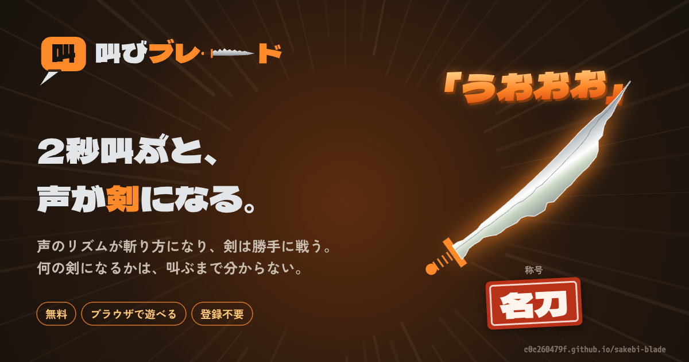
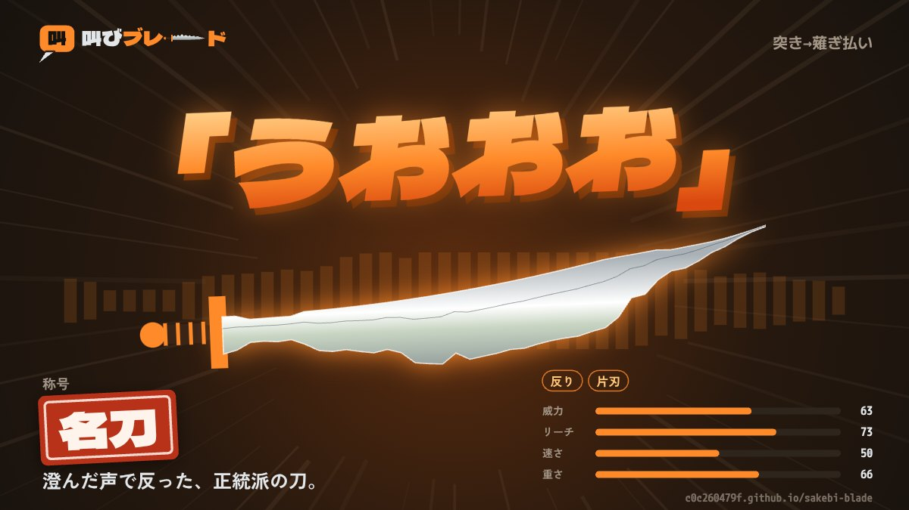
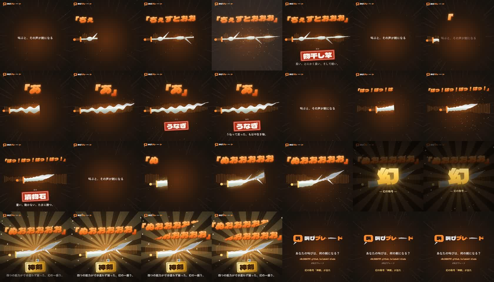

# 叫びブレード

**2秒叫ぶと、その声が剣になる。** 声の形が剣の形に、声のリズムが斬り方になり、剣同士が勝手に戦うブラウザゲームです。

▶ **遊ぶ：https://c0c260479f.github.io/sakebi-blade/** （無料・登録不要。マイクがなくても、音声・動画ファイルの音やサンプルで遊べます）

サーバーは使わず、1枚のHTMLだけで動いています。声の解析、3Dの対戦、自慢用の画像や動画の生成まで、すべて遊ぶ人のブラウザの中で処理します。録音は端末の外に一切送りません。

---

## 遊び方

1. 叫ぶ言葉（剣の名前）を入れて、「押して叫ぶ」で2秒叫ぶ
2. 声から剣が鍛えられる。能力・形・斬り方・**称号**が決まる
3. 剣は自動で戦う。プレイヤーが決めるのは最初の出撃位置だけ
4. 道場の剣士10人を順に倒す。負けたら叫び直して、同じ相手に何度でも挑める
5. できた剣は画像か声つき動画にして、Xに自慢できる。投稿には、見た人がその剣と戦えるURLが付く

| 自慢用の画像 | 声つき動画（約6秒）のコマ |
|---|---|
|  |  |

---

## 声が剣になる仕組み

### 1. 声を測る（`analyze` / `pitchContour`）
- 20msごとの音量（RMS）を取り、叫んでいる区間を切り出して **40点の音量の推移** にする
- 声の大きさは、マイクの感度に左右されないよう **周りの静けさとの差（SN比）** で測る。最初は音量の絶対値で測っていたが、マイクによって威力が1に張り付いたので作り直した
- 声の高さは **自己相関** でフレームごとに推定し、その中央値を使う。高さの推移からは、上げ下げ（半音単位の傾き）と、震え（毎秒3.5〜9.5回の揺れ）を取り出す
- 自己相関の強さを **声の澄み具合（周期性）** として使う

### 2. 能力にする（`statsOf`）
声の測り方を、威力・リーチ・速さ・重さの4つ（1〜99）に変換します。
- 長さ → リーチ、大きさ → 威力と重さ、高さ → 鋭さと速さ（高い声ほど軽くて速い）
- どれかを上げると別のどれかが下がる **トレードオフ** にしてあり、万能な剣は出にくい
- 能力が真ん中に固まると勝負が地味になるので、分布を広げて尖らせている
- 80以上の能力は **異能**（剛剣・長刀・疾風・不動）になり、三すくみの相性がある

### 3. 剣の形にする（`buildShape`）
音量の推移がそのまま刃の幅の輪郭になります。さらに声の特徴で形が変わります。
- 語尾の上げ下げ → **反り**、3回以上区切る → **枝刃**、声の震え → **波刃**、澄んだ声 → **片刃**

### 4. 斬り方にする（`rhythmOf`）
音量の推移を区切りで分けて、短い区切りは **突き**、伸ばした部分は **薙ぎ払い** になります。「はっ！はっ！はっ！」と叫べば3連突きです。対戦中は、斬るたびにその区切りの自分の叫び声が鳴ります。

### 5. 称号をつける（`titleOf`）
能力と形から「物干し竿」「つまようじ」「漬物石」などの称号がつきます。画像や動画のオチになります。条件のとても狭い激レア称号や、隠し要素もあります。

---

## 対戦

- 円形の舞台で、2本の剣が自動で動いて斬り合う。舞台は時間とともに崩れて狭くなり、場外に落ちたら負け
- 斬られた剣は折れて短くなるが、そのぶん軽く速くなる。押されている側の折れた剣は相手の懐へ飛び込み、柄を打てば大ダメージ。**逆転** が起きるようにしている
- 道場の剣士はそれぞれ声の高さや荒さが違い、仮名を音節に分けて母音と子音を合成した **その剣士の声** で叫ぶ

### バランスの確かめ方
ブラウザの画面を省いた **Node.js 上のシミュレーター** で、剣を数千本作って総当たりで戦わせて調整しました。
- 道場の勝率：1人目およそ90% → 10人目およそ27%
- 異能の三すくみ：有利な側の勝率が57〜60%
- 逆転勝ち（体力で負けている側が勝つ）：およそ30%

画面の崩れやスマホでの見え方は、Playwright でヘッドレスの Chromium を動かして確認しています。

---

## 共有の仕組み

- **果たし状URL**：剣の測定値（長さ・高さ・40点の音量の推移など）を50〜80バイトほどに詰めて、URLの `#` 以降に入れる。開いた人のブラウザで同じ剣を作り直すので、サーバーは要らない。送る前に測定値を同じ精度に丸めておくことで、送った剣と届いた剣の能力が1も狂わないようにした（3000本で一致を確認）
- **自慢用の画像**：Canvas 2D で 1200×675 の画像を描く
- **声つき動画**：Canvas に描いたアニメーションを `captureStream` で映像にし、Web Audio で叫び声と効果音を混ぜて `MediaRecorder` で録る。毎フレーム描く重い部品（影つきの文字、光る剣）は一度だけ描いて使い回し、スマホでもコマ落ちしにくくしている

---

## 使った技術

- HTML / CSS / JavaScript（ビルドなしの1ファイル）
- three.js r128（3D表示、ブルームなどの後処理）
- Web Audio API（録音の解析、合成音声、効果音、動画の音声）
- MediaRecorder / Canvas 2D（画像と動画の生成）
- localStorage / IndexedDB（保管庫と自分の声の保存。端末の中だけ）
- GitHub Pages（公開）
- 検証：Node.js のシミュレーター、Playwright

## 苦労したところ

- **マイクごとの差**：同じ叫びでも端末によって音量が大きく違い、威力が1になる人が出た。周りの静けさとの差で測る方式に変えて解決した
- **高い声で速さが上がらない**：最初は声の高さの範囲を広く取りすぎていて、人が出せる高さでは速さが30前後で頭打ちになっていた。人が叫べる範囲（およそ110〜900Hz）に合わせて計算し直した
- **URLで送ると能力が変わる**：数値を丸めた影響で、送った剣の異能が消えることがあった。剣を作る段階で、URLと同じ精度に揃えてから計算するようにした
- **自動対戦の面白さ**：短くなった剣が全く当たらなくなる、ため続けるだけでどの剣でも勝てる、などの問題が出た。操作を出撃位置だけにして、折れた剣が懐に飛び込む仕組みを入れた

---

開発：Ada（[@c0c260479f](https://github.com/c0c260479f)）／ AIアシスタントの Claude と一緒に作りました
